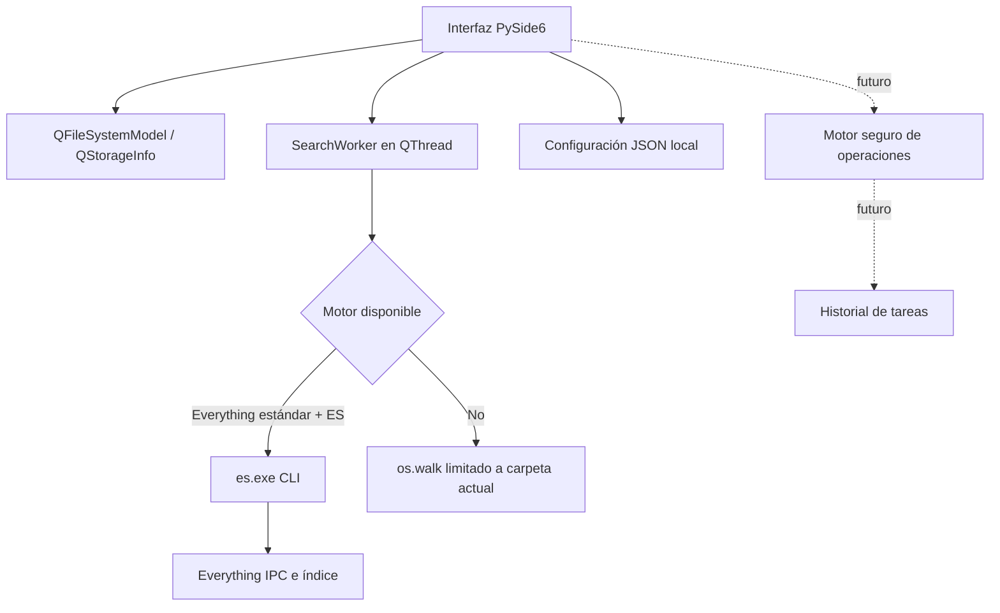

# 02 · Arquitectura y especificación de OmniFiles

**Estado:** diseño y prototipo 0.1, 2026-11-05.  
**Plataforma objetivo:** Windows 10/11, escritorio local.  
**Principio:** que encontrar, navegar y organizar archivos sea más sencillo que alternar varias herramientas.

## 1. Objetivos de experiencia de usuario

- Una ventana principal: unidades visibles, barra de dirección, favoritos, vista de archivos y búsqueda.
- Consulta transversal rápida por nombre cuando Everything esté disponible.
- Sin resultados ambiguos: indicar **motor y alcance** de cada búsqueda.
- Sin acciones ocultas: una búsqueda jamás mueve, borra o reescribe archivos.
- En operaciones futuras: confirmación, conflictos resueltos explícitamente, registro y opción de cancelar antes de comenzar.

## 2. Arquitectura lógica

El paquete `omnifiles` contiene:

| Archivo | Responsabilidad | ¿Ejecuta cambios sobre archivos del usuario? |
|---|---|---|
| `core.py` | Formato, validación de rutas, limpieza de resultados | No |
| `search.py` | Adaptador ES y escaneo local con límites | No |
| `app.py` | Interfaz, navegación, favoritos, hilos y diálogos | Solo escribe preferencias propias |
| `__main__.py` | Punto de arranque | No |
| `tests/` | Pruebas unitarias sobre archivos temporales | Solo datos temporales de pruebas |

## 3. Alcance de la versión 0.1

### Funcional

1. Listar todos los **volúmenes montados** reportados por Qt y sus capacidades.
2. Navegar por rutas existentes, retroceder, avanzar, ir a inicio y subir carpeta.
3. Abrir archivos con la aplicación asociada y copiar su **ruta** al portapapeles.
4. Mantener favoritos entre sesiones sin alterar la configuración del Explorador de Windows.
5. Buscar con Everything a través de ES si se configura, mostrando un máximo de 400 rutas.
6. Sin ES: pedir autorización para una búsqueda local por nombre con límites (8 segundos, 10,000 directorios y 400 resultados).

### Fuera de alcance explícito

Copiar, mover, renombrar y borrar, creación de carpetas, doble panel, inspección real de discos físicos, integridad/duplicados, indexación propia, búsquedas sobre contenido y métricas de rendimiento. No prometerlas como entregadas.

## 4. Requisitos no funcionales y protecciones

- **Solo lectura para archivos explorados** en MVP. No hay llamadas a `unlink`, `rmtree`, `rename`, `move` ni comandos de particionado.
- Hilos: `QFileSystemModel` realiza carga asíncrona de directorios; búsquedas se llevan a `QThread` para mantener viva la interfaz.
- ES: `subprocess.run` con `shell=False`, salida capturada, timeout 10 segundos, límite 400, sin ejecución arbitraria de parámetros de shell.
- Escaneo local: no sigue enlaces simbólicos de directorios, tiene límites y permisos de acceso gestionados. Puede devolver resultados parciales y lo indica.
- Estado: JSON en `%LOCALAPPDATA%\OmniFiles\settings.json`. Escribir de forma atómica mediante archivo `.tmp` y reemplazo.
- Uso offline: el explorador funciona sin Everything ni acceso a Internet.
- Red: ninguna solicitud de red propia. Everything puede gestionar sus características aparte; OmniFiles solo usa IPC local.

## 5. Evolución priorizada

**P1 (después de validación Windows):** mejoras de navegación y búsqueda: pestañas, arrastrar y soltar controlado, filtros visuales, selección múltiple, ordenar columnas y mensajes claros cuando un volumen no está indexado.

**P2 (conjunto de operaciones de archivos):** copiar/mover/renombrar, colas y progreso, cancelación y recuperación ante errores. Antes: pruebas con árboles temporales y volúmenes no críticos; protección contra sobrescritura, ciclos, symlinks, archivos abiertos y cambios de unidad.

**P3 (análisis del espacio):** lista de archivos grandes y explorador por tamaños, control de tiempo y permisos; evitar escanear todo C: automáticamente.

**P4 (opcional):** duplicados por tamaño+hash con verificación, previsualización, favoritos avanzados, empaquetado/instalador.

## 6. Decisiones técnicas pendientes

| Decisión | Opción inicial | Validación requerida |
|---|---|---|
| Gestor gráfico | PySide6/Qt6 | Prueba real en Windows 10 español |
| Buscador externo | ES CLI en vez de SDK DLL | Latencia, Unicode, distribución |
| Índice independiente | No | Solo si Everything resulta insuficiente |
| Almacenamiento de preferencias | JSON local | Tolerancia a archivos corruptos y rutas desconectadas |
| Licencia del código propio | Sin selección aún | Decidir antes de publicar |
| Instalador | No en fase 0.1 | Empaquetado y derechos de terceros |

## 7. Riesgos detectados

1. **Riesgo de confundir volumen/disco:** las letras C/D/E/F son volúmenes lógicos, no identificadores físicos.
2. **Dependencia de Everything:** su servicio, índice y licencia son independientes del prototipo. La edición Lite de Everything 1.4 no permite IPC.
3. **Problemas de consola Unicode:** la salida de ES necesita verificación en la máquina destino.
4. **Escaneos grandes:** incluso el modo local limitado puede consumir E/S. Por eso no comienza sin confirmación.
5. **Licencias:** el código propio no incorpora GPL de Double Commander; las condiciones de PySide6/Qt y terceros se revisarán antes de distribuir.
6. **Pruebas de GUI ausentes:** en el entorno de generación no estuvo instalado PySide6 (instalación no disponible en el índice); la interfaz solo tuvo validación sintáctica, no visual/funcional en Windows.
